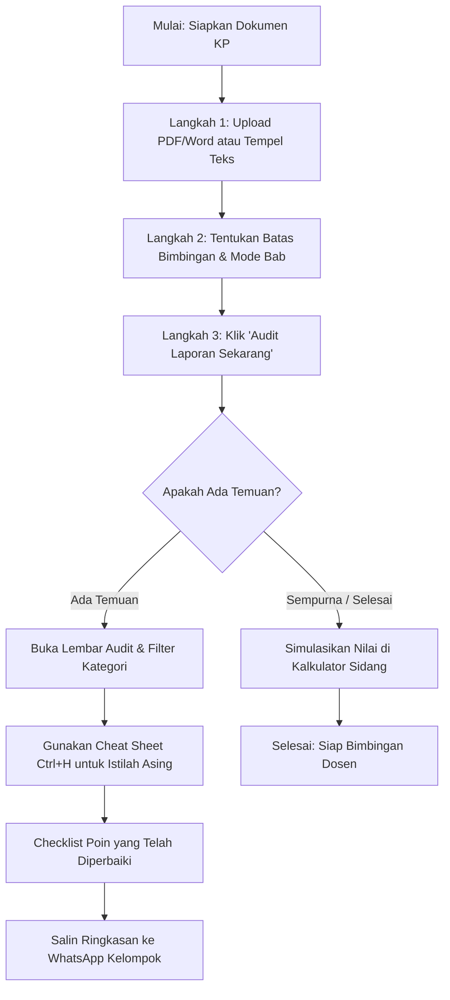

# 🎓 KP Validator by ncexs — Sistem Audit & Pengecekan Otomatis Laporan Kerja Praktek

[](https://ncexs.github.io/unpam-kp-validator/)
[](https://github.com/ncexs)
[](LICENSE)
[](#)
[](#)
[](#)

> **Aplikasi Web Interaktif (Single Page Application)** yang dikembangkan oleh **ncexs** untuk membantu mahasiswa **Program Studi Sistem Informasi (S1)** mengaudit, memeriksa format penulisan, kelengkapan sub-bab, kecukupan sitasi literatur, istilah asing, dan lampiran laporan Kerja Praktek (KP) secara otomatis sebelum diajukan ke Dosen Pembimbing & Penguji.

---

## 📌 Daftar Isi
- [Latar Belakang & Masalah](#-latar-belakang--masalah)
- [Fitur Utama & Keunggulan](#-fitur-utama--keunggulan)
  - [1. Multi-Format Document Parser (.PDF, .DOCX, & Manual Paste)](#1-multi-format-document-parser-pdf-docx--manual-paste)
  - [2. Multi-Stage Scope Selection (Kumulatif vs Per-Bab)](#2-multi-stage-scope-selection-kumulatif-vs-per-bab)
  - [3. Zero False-Positive Dynamic IT Foreign Terms Audit](#3-zero-false-positive-dynamic-it-foreign-terms-audit)
  - [4. Lembar Audit Temuan Terintegrasi (Unified Audit Sheet)](#4-lembar-audit-temuan-terintegrasi-unified-audit-sheet)
  - [5. Generator Template Mandiri](#5-generator-template-mandiri)
  - [6. Cheat Sheet Find & Replace Word (Ctrl + H)](#6-cheat-sheet-find--replace-word-ctrl--h)
  - [7. Kalkulator Simulasi Nilai Sidang KP](#7-kalkulator-simulasi-nilai-sidang-kp)
  - [8. Desain Adaptif & Ramah Layar HP (Mobile-Ready)](#8-desain-adaptif--ramah-layar-hp-mobile-ready)
  - [9. 100% Client-Side Privacy & Keamanan Data](#9-100-client-side-privacy--keamanan-data)
- [Arsitektur & Teknologi](#-arsitektur--teknologi)
- [Panduan Penggunaan Langkah demi Langkah](#-panduan-penggunaan-langkah-demi-langkah)
- [Struktur Direktori Proyek](#-struktur-direktori-proyek)
- [Panduan Instalasi & Menjalankan Lokal](#-panduan-instalasi--menjalankan-lokal)
  - [Cara 1: Tanpa Instalasi (Direct Open)](#cara-1-tanpa-instalasi-direct-open)
  - [Cara 2: Menggunakan Local Development Server](#cara-2-menggunakan-local-development-server)
  - [Cara 3: Deployment ke Web Hosting / GitHub Pages](#cara-3-deployment-ke-web-hosting--github-pages)
- [Kontribusi](#-kontribusi)
- [Pengembang & Lisensi](#-pengembang--lisensi)

---

## 💡 Latar Belakang & Masalah

Proses bimbingan Kerja Praktek (KP) sering kali terhambat oleh revisi berulang terkait aspek-aspek administratif dan tata cara penulisan ilmiah:
- **Format Typo & Layout**: Kesalahan margin kertas, jenis font, ukuran spasi, atau penomoran halaman Romawi (`i, ii, iii`) dan Arab (`1, 2, 3`).
- **Sub-Bab Wajib Terlewat**: Bagian esensial seperti *Tinjauan Pustaka*, *Kerangka Berpikir*, atau diagram analisis UML sering kali lupa dicantumkan.
- **Kekurangan Literatur Ilmiah**: Syarat batas minimum jurnal terakreditasi 5 tahun terakhir (2021–2026) dan referensi buku teks belum terpenuhi.
- **Istilah Asing Belum Miring (*Italic*)**: Kata-kata teknis bahasa Inggris di ranah sistem informasi (*database, backend, API, framework, login, online, real-time*) masih ditulis dengan huruf tegak.
- **Teks Artefak / Bekas Copy-Paste**: Tertinggalnya nama instansi atau judul aplikasi lama yang tidak relevan akibat salin-tempel dari template laporan lain.
- **Lampiran Wajib Kurang**: Dokumen esensial seperti SIUP/NIB instansi tempat magang dan surat kerja sama institusi belum dilampirkan.

**KP Validator by ncexs** dirancang sebagai asisten audit mandiri pra-bimbingan untuk mendeteksi seluruh ketidaksesuaian tersebut dalam hitungan detik.

---

## ✨ Fitur Utama & Keunggulan

### 1. Multi-Format Document Parser (.PDF, .DOCX, & Manual Paste)
- **Ekstraksi PDF Berpresisi Tinggi**: Menggunakan **PDF.js** dengan *inline blob worker* agar bebas hambatan lintas domain (CORS). Mendeteksi gaya font asli (*italic* vs *normal*) dan melacak koordinat nomor halaman (`Hal. X`).
- **Pembersihan Bersih Dokumen Word (.DOCX)**: Menggunakan **Mammoth.js** yang telah disanitasi secara mendalam. Tag non-italic HTML seperti `<strong>`, `<table>`, `<p>`, serta entitas HTML (`&amp;`, `&quot;`) disaring tuntas sehingga tidak bocor ke dalam deteksi kosa kata.
- **Mode Tempel Teks Manual**: Menyediakan area input teks fleksibel untuk pengujian cepat per paragraf atau draf parsial.

### 2. Multi-Stage Scope Selection (Kumulatif vs Per-Bab)
Mendukung alur bimbingan bertahap mahasiswa:
- **Mode Kumulatif**:
  - *Sampai BAB I*: Cover, Lembar Pengesahan, Abstrak, Sistematika Penulisan, dan 9 Sub-Bab Pendahuluan.
  - *Sampai BAB II*: Profil Perusahaan, Tinjauan Pustaka, Teori Pendukung, 20 Jurnal & 5 Buku Referensi.
  - *Sampai BAB III*: Analisis Sistem Berjalan, UML (Use Case, Activity, Sequence, Class Diagram), UI Wireframe, dan Matriks Pengujian Black Box.
  - *Lengkap (BAB I–IV Full + Lampiran)*: Target minimal 50 halaman, Kesimpulan, Saran, Daftar Pustaka, serta 8 Lampiran Wajib.
- **Mode Per-Bab Saja (Fokus)**:
  - Khusus mengaudit BAB I saja, BAB II saja, BAB III saja, atau BAB IV saja tanpa memunculkan peringatan dari bab lain yang memang belum dikerjakan.

### 3. Zero False-Positive Dynamic IT Foreign Terms Audit
Algoritma deteksi istilah asing generasi baru dengan akurasi tinggi:
- **Kamus Kosakata TI Multidisiplin**: Mencakup lebih dari 100+ istilah asing di bidang Web Development, Mobile, Artificial Intelligence / Machine Learning, Cloud Computing, IoT, Cyber Security, Database, Jaringan, dan UI/UX.
- **Stemmer Morfologi Bahasa Indonesia**: Mengeliminasi kesalahan penandaan kata berbahasa Indonesia yang berimbuhan kompleks:
  - Awalan: `meng-`, `peng-`, `di-`, `ter-`, `ber-`, `pe-`, `se-`.
  - Akhiran: `-kan`, `-an`, `-i`, `-nya`.
  - Kata Ulang / Reduplikasi: `masing-masing`, `langkah-langkah`, `faktor-faktor`.
- **Kamus Luring Bawaan (Offline Core Fallback)**: Mengantongi ratusan kata baku akademik bahasa Indonesia langsung di memori klien.
- **Sinkronisasi Daring Asinkron**: Secara non-blocking memperkaya database kata dari repositori leksikon bahasa Indonesia terbuka (Ivan Lanin & Sastrawi).
- **Indikator Halaman & Frekuensi**: Menyajikan info frekuensi kemunculan kata (`Nx`) dan nomor halaman persisnya (`Hal. X`).

### 4. Lembar Audit Temuan Terintegrasi (Unified Audit Sheet)
- **Hanya Menampilkan Temuan yang Salah**: Membebaskan layar dari informasi yang tidak perlu; hanya masalah yang butuh perbaikan yang ditampilkan.
- **Filter Tab Kategori**: Beralih cepat antara tab *Semua Temuan*, *Format & Pra-Bab*, *Sistematika Bab*, *Sitasi Literatur*, *Istilah Asing*, dan *Lampiran Dokumen*.
- **Live Real-Time Search**: Kolom pencarian instan untuk memfilter temuan berdasarkan kata kunci atau nomor bab.
- **Checklist Interaktif & Local Storage**: Tandai temuan yang sudah Anda selesaikan di Word; progress checklist tersimpan otomatis di peramban tanpa hilang saat halaman dimuat ulang.
- **Export Ringkasan 1-Klik ke WhatsApp**: Menyusun pesan teks berformat rapi dengan poin-poin revisi yang siap dibagikan ke grup kelompok bimbingan.
- **Cetak Lembar Audit Mandiri**: Tata letak ramah cetak (*print-friendly*) untuk dijadikan lampiran bukti pengecekan mandiri.

### 5. Generator Template Mandiri
Membantu mahasiswa menyusun konten laporan yang sering menjadi sumber revisi dosen:
- **Generator Benang Merah Masalah**: Menghubungkan alur koheren antara *Masalah Operasional Lapangan* $\rightarrow$ *Dampak Negatif terhadap Proses Bisnis* $\rightarrow$ *Solusi Sistem Informasi Berbasis TI*.
- **Generator Tabel 2.1 Tinjauan Pustaka (Standar 6 Kolom Akademik)**: Menghasilkan tabel matriks perbandingan penelitian terdahulu (No, Peneliti & Tahun, Judul Publikasi, Metode/Alat, Hasil yang Dicapai, Relevansi terhadap KP).
- **Generator Matriks Pengujian Black Box**: Menghasilkan kerangka pengujian fungsional sistem (No, Skenario Pengujian, Kasus Uji, Data Masukan, Hasil yang Diharapkan, Hasil Pengamatan, Kesimpulan Status).

### 6. Cheat Sheet Find & Replace Word (<kbd>Ctrl + H</kbd>)
Setiap istilah asing yang terdeteksi masih berhuruf tegak dilengkapi dengan tombol **salin cepat 1-klik**. Mahasiswa cukup menekan tombol tersebut, membuka Microsoft Word, menekan <kbd>Ctrl + H</kbd>, menempelkan kata pada kolom *Find*, dan mengaktifkan format *Italic* pada kolom *Replace*.

### 7. Kalkulator Simulasi Nilai Sidang KP
Mengalkulasi estimasi perolehan nilai sidang akhir Kerja Praktek berdasarkan bobot standar penilaian akademik:
- **40%** — Penguasaan Sistem & Program Aplikasi yang Dibangun.
- **20%** — Sistematika Penulisan, Tata Bahasa, dan Format Buku Laporan.
- **40%** — Keaktifan Bimbingan, Kelengkapan Logbook, dan Presentasi Sidang.
- Mengonversi total skor numerik (0–100) menjadi **Nilai Mutu Huruf (A, B, C, D)** dan **Predikat Kelulusan**.

### 8. Desain Adaptif & Ramah Layar HP (Mobile-Ready)
- Tipografi proporsional dengan skala dinamis untuk perangkat mobile (`text-xs: 13px`, `text-sm: 14px`, `text-base: 16px`).
- Tombol aksi dan area upload otomatis bertumpuk (*stacked*) pada layar kecil demi kenyamanan sentuhan jari.
- Tab navigasi geser horizontal (*touch-pan*) halus tanpa memicu luapan (*horizontal scrollbar* tersembunyi).
- Badge lokasi dan nama dokumen otomatis terpotong elipsis (`truncate`) sehingga tidak merusak tata letak kartu audit.

### 9. 100% Client-Side Privacy & Keamanan Data
- Seluruh berkas PDF, DOCX, dan teks diproses langsung di dalam memori JavaScript browser pengguna (*sandbox client-side*).
- **Nol Server Backend**: Tidak ada dokumen, data mahasiswa, maupun informasi instansi tempat magang yang dikirim atau disimpan di peladen pihak ketiga.

---

## 🛠️ Arsitektur & Teknologi

```
┌─────────────────────────────────────────────────────────────┐
│                    Browser Klien (SPA)                      │
├───────────────────────────────┬─────────────────────────────┤
│  Antarmuka Pengguna (UI)      │  Tailwind CSS + FontAwesome │
├───────────────────────────────┼─────────────────────────────┤
│  Ekstraksi Dokumen            │  PDF.js (Inline Worker Blob)│
│                               │  Mammoth.js (Word Sanitize) │
├───────────────────────────────┼─────────────────────────────┤
│  Mesin Validasi & Audit       │  Vanilla JS (ES6+ Engine)   │
│  - Indonesian Morphology      │  - Affix Stemmer & Rules    │
│  - Foreign Words Detection    │  - Multi-Domain IT Glossary │
│  - Page Number Tracker        │  - PDF Font/Style Matrix    │
├───────────────────────────────┼─────────────────────────────┤
│  Penyimpanan Status           │  HTML5 LocalStorage API     │
└───────────────────────────────┴─────────────────────────────┘
```

- **HTML5 & Vanilla JavaScript (ES6+)**: Logika aplikasi berkinerja tinggi tanpa ketergantungan framework berat.
- **Tailwind CSS (CDN)**: Sistem desain modern, responsif, dan konsisten.
- **PDF.js by Mozilla**: Pustaka rendering dan ekstraksi teks PDF berstandar industri dengan implementasi *Blob worker URL* bebas CORS.
- **Mammoth.js**: Konverter dokumen `.docx` ke struktur teks dengan pembersihan tag HTML ketat.
- **Google Fonts (Plus Jakarta Sans & JetBrains Mono)**: Tipografi modern berkarakter akademik dan teknis.

---

## 📖 Panduan Penggunaan Langkah demi Langkah



1. **Langkah 1 — Unggah Dokumen**:
   - Tarik dan letakkan (*drag & drop*) file draf laporan Anda berformat `.pdf` atau `.docx` ke area kotak dropzone.
   - Alternatif lain, klik **Tempel Teks** jika Anda ingin menguji potongan bab tertentu secara langsung.
2. **Langkah 2 — Atur Batas Bab & Mode Pengecekan**:
   - Pilih tahapan bimbingan Anda (*Sampai BAB I*, *Sampai BAB II*, *Sampai BAB III*, atau *Lengkap BAB I–IV*).
   - Tentukan cakupan: **Kumulatif** (mengecek dari awal hingga bab tersebut) atau **Per-Bab Saja** (khusus memvalidasi bab tersebut secara terisolasi).
3. **Langkah 3 — Jalankan Audit Otomatis**:
   - Klik tombol utama **Audit Laporan Sekarang**. Sistem akan memproses dokumen dalam hitungan detik.
4. **Langkah 4 — Perbaiki Temuan & Manfaatkan Fitur Bantuan**:
   - Tinjau kartu temuan revisi pada **Lembar Audit Temuan**.
   - Gunakan filter kategori atau kotak pencarian untuk fokus pada revisi tertentu.
   - Pada bagian istilah asing, klik tombol salin di samping kata untuk segera menggantinya menjadi cetak miring di Word menggunakan <kbd>Ctrl + H</kbd>.
   - Manfaatkan **Generator Template** jika Anda membutuhkan format standar Benang Merah Masalah, Tabel Tinjauan Pustaka, atau Matriks Black Box.
5. **Langkah 5 — Ekspor & Koordinasi**:
   - Klik **Salin Semua ke WA** untuk membagikan daftar revisi ke rekan satu kelompok.
   - Gunakan **Kalkulator Nilai Sidang** untuk memperkirakan potensi nilai akhir berdasarkan kualitas draf dan kesiapan Anda.

---

## 📂 Struktur Direktori Proyek

```
kp-validator/
├── index.html          # Aplikasi utama (UI, Tailwind, PDF.js, Mammoth, & Audit Engine)
├── src/
│   └── utils.js        # Utilitas modul pembantu (deteksi font italic, konversi nilai)
├── favicon.svg         # Ikon aplikasi vektor resmi
├── LICENSE             # Lisensi perangkat lunak terbuka (MIT License)
├── README.md           # Dokumentasi komprehensif proyek
└── .gitignore          # Konfigurasi pengecualian berkas git
```

---

## 🚀 Panduan Instalasi & Menjalankan Lokal

Aplikasi ini tidak memerlukan instalasi runtime khusus, build tool (seperti Node.js, Webpack, atau Vite), maupun konfigurasi basis data. Anda dapat langsung menjalankannya dalam hitungan detik!

### Cara 1: Tanpa Instalasi (Direct Open)
1. Unduh atau clone repositori ini ke komputer Anda:
   ```bash
   git clone https://github.com/ncexs/unpam-kp-validator.git
   ```
2. Buka folder proyek hasil unduhan.
3. Klik dua kali (*double click*) pada berkas `index.html`. Aplikasi akan langsung terbuka dan berjalan sempurna di peramban web default Anda (Chrome, Edge, Firefox, Safari).

### Cara 2: Menggunakan Local Development Server
Untuk pengalaman pengembangan lokal yang optimal:
- **Menggunakan VS Code Live Server**:
  1. Pasang ekstensi **Live Server** di Visual Studio Code.
  2. Buka folder proyek di VS Code.
  3. Klik kanan pada berkas `index.html` $\rightarrow$ pilih **"Open with Live Server"**.
- **Menggunakan Python**:
  ```bash
  # Python 3
  python -m http.server 8000
  ```
  Buka peramban di `http://localhost:8000`.
- **Menggunakan Node.js (`serve` atau `http-server`)**:
  ```bash
  npx serve .
  ```

### Cara 3: Deployment ke Web Hosting / GitHub Pages
Karena merupakan *Single Page Application* statis murni, proyek ini dapat dihosting secara gratis di berbagai platform:
- **GitHub Pages**: Cukup aktifkan opsi GitHub Pages pada tab *Settings* $\rightarrow$ *Pages* repositori Anda (pilih branch `main` root `/`).
- **Cloudflare Pages / Vercel / Netlify**: Hubungkan repositori GitHub Anda; biarkan *build command* kosong dan set *publish directory* ke root `.`.

---

## 🤝 Kontribusi

Kontribusi untuk menyempurnakan perbendaharaan kata istilah asing, aturan pedoman penulisan, maupun peningkatan performa ekstraksi teks sangat disambut baik!

1. Fork repositori ini.
2. Buat branch fitur baru Anda:
   ```bash
   git checkout -b fitur/peningkatan-kamus-ti
   ```
3. Lakukan commit perubahan Anda:
   ```bash
   git commit -m "feat: tambahkan kosa kata istilah arsitektur cloud"
   ```
4. Push branch ke GitHub Anda:
   ```bash
   git push origin fitur/peningkatan-kamus-ti
   ```
5. Buat sebuah **Pull Request**.

---

## 👨‍💻 Pengembang & Lisensi

- **Lead Developer**: [ncexs](https://github.com/ncexs)
- **Lisensi**: Proyek ini dilisensikan di bawah naungan **[MIT License](LICENSE)**. Bebas digunakan, dipelajari, dan dikembangkan demi kemajuan akademik dan kemudahan mahasiswa dalam menyelesaikan laporan Kerja Praktek!
